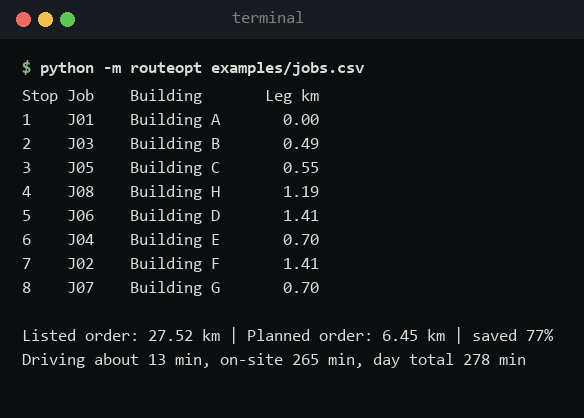

<p align="center"></p>

# dispatch-route-optimizer

[](https://github.com/yassine2med/dispatch-route-optimizer/actions/workflows/ci.yml)  

Puts a technician's job stops in a driving order that cuts travel, and shows how many kilometres and minutes the new order saves. Standard library only.



## What it is for

Work orders reach a dispatcher in the order they were created, not in the order a technician should drive them. A day of eight jobs across a campus or a city can easily have the van crossing the same streets twice. Dispatchers, facility coordinators and field supervisors use this tool to feed in the day's jobs with coordinates and get back one sensible visiting order, with the distance before and after, and an estimate of driving time plus on-site time.

## Install

```
git clone https://github.com/yassine2med/dispatch-route-optimizer
cd dispatch-route-optimizer && pip install -r requirements.txt
```

## How to use

| I want to | Command |
|---|---|
| Plan the route for a jobs file | `PYTHONPATH=src python -m routeopt examples/jobs.csv` |
| Force the first stop (a job id) | `PYTHONPATH=src python -m routeopt examples/jobs.csv --start J05` |
| Change the average driving speed in km/h (default 30) | `PYTHONPATH=src python -m routeopt examples/jobs.csv --speed 40` |
| Show help | `PYTHONPATH=src python -m routeopt --help` |

The CSV has the columns `id, building, lat, lon` and an optional `minutes` for time on site (default 30). Without `--start` the first row is the starting stop. Exit codes: 0 on success, 1 for a missing file, a bad row (non-numeric or out of range coordinates, duplicate id) or a bad option.

Example with the invented jobs in `examples/jobs.csv`:

```
PYTHONPATH=src python -m routeopt examples/jobs.csv
```

Output:

```
Stop Job    Building       Leg km
1    J01    Building A       0.00
2    J03    Building B       0.49
3    J05    Building C       0.55
4    J08    Building H       1.19
5    J06    Building D       1.41
6    J04    Building E       0.70
7    J02    Building F       1.41
8    J07    Building G       0.70

Listed order: 27.52 km | Planned order: 6.45 km | saved 77%
Driving about 13 min, on-site 265 min, day total 278 min
```

Run the tests with `python -m pytest -q`.

## How it works

1. Distances are great-circle (haversine) kilometres between coordinates.
2. A nearest neighbour pass builds a first route: from the current stop, always go to the closest stop not yet visited.
3. A 2-opt pass then reverses any stretch of the route whose reversal makes the total shorter, and repeats until nothing improves.
4. The route is an open path: it starts at the first stop and does not return to a depot.
5. Driving time is the planned distance divided by the speed. On-site time is the sum of the minutes column.

## Limits

- Straight line distance, not road distance. Real routes with one way streets, bridges and traffic will be longer.
- No time windows, no technician skills, no vehicle limits and no return trip. It orders stops for one technician.
- 2-opt gives a good route, not a guaranteed best one. For about a dozen stops the result is usually very close.
- The listed distance uses the file order, so it only shows a saving when the file is not already ordered.

## License

MIT. Yassine Emhamed, 2026.
